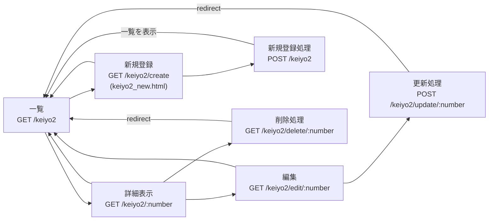

# 京葉線アプリ（keiyo2）のページ遷移図（10-2）

スライド18ページの図をもとに，自分の実装に合わせて書いた．
削除は詳細ページから行うことにした．どの駅を消すのか中身を見てから消せるので，一覧から直接消すより間違いが少ないと考えた．

- `:number` は配列 station2 の添字で，駅の id とは別もの．削除すると後ろの駅の添字がずれるが，一覧から毎回リンクし直すので問題はない．
- 存在しない番号で詳細・編集・更新・削除にアクセスした場合は 404 を返し，一覧へのリンクを出す．
