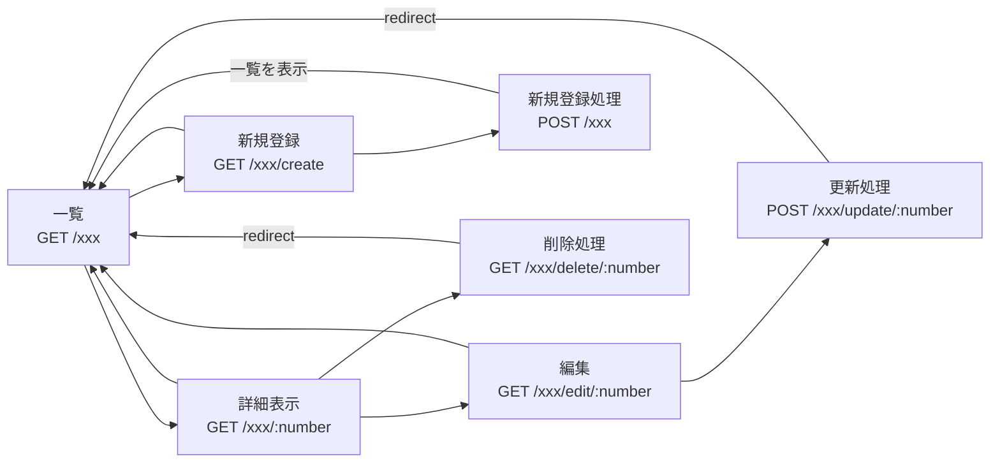

# レポート用システムの設計メモ（10-2）

京葉線以外の一覧表示ベースの Web アプリを 3 つ開発する。題材はアンケートで提出した本命の 3 つにした。
筋トレ関係でまとめたので、記録・種目・プロテインと扱うデータの性格がそれぞれ違うものになっている。
データはサーバ側の変数（配列）に保持する。最初に考えた案（家計簿・課題管理・食材在庫）は report_design_old.md に残してある。

3 つとも keiyo2 と同じリソース名・ページ遷移にそろえる（スライドの「統一した操作」）。
`/xxx` の部分をそれぞれ `/training`、`/exercise`、`/protein` に置き換えるだけで同じ操作になるようにする。

## 共通のリソース名

機能 | method | リソース名
-|-|-
一覧 | get | /xxx
新規登録（フォーム） | get | /xxx/create
新規登録（処理） | post | /xxx
詳細表示 | get | /xxx/:number
編集（フォーム） | get | /xxx/edit/:number
更新（処理） | post | /xxx/update/:number
削除（処理） | get | /xxx/delete/:number

`:number` は配列の添字。keiyo2 と同じく削除は詳細ページから行う。

## 共通のページ遷移図

---

## 1. 筋トレ記録システム（/training）

日々のトレーニングで何をどれだけやったかを記録する。利用者は自分の伸びを確認したい人。
日付と数値（重量・回数）が中心。

項目名 | 型 | 説明
-|-|-
id | 数値 | 通し番号
date | 文字列 | 実施日（例: "2026-11-27"）
exercise | 文字列 | 種目名（例: "ベンチプレス"）
weight | 数値 | 重量（kg、自重なら 0）
reps | 数値 | 1 セットの回数
sets | 数値 | セット数
memo | 文字列 | 備考（空でもよい）

一覧には日付・種目・重量を出し、詳細で回数やメモまで見せる。

## 2. トレーニング種目図鑑システム（/exercise）

筋トレの種目を部位ごとに調べられる図鑑。記録システムと違って日付は無く、説明文が長めになる。

項目名 | 型 | 説明
-|-|-
id | 数値 | 通し番号
name | 文字列 | 種目名（例: "スクワット"）
part | 文字列 | 主に鍛える部位（胸/背中/脚/肩/腕/腹）
equipment | 文字列 | 使う器具（バーベル/ダンベル/マシン/自重）
level | 数値 | 難易度（1〜3）
point | 文字列 | フォームのポイント

一覧には種目名と部位を出す。

## 3. プロテイン比較システム（/protein）

市販のプロテインを値段や成分で比べる。比較が目的なので数値の項目が多い。

項目名 | 型 | 説明
-|-|-
id | 数値 | 通し番号
name | 文字列 | 商品名
maker | 文字列 | メーカー名
type | 文字列 | 種類（ホエイ/ソイ/カゼイン）
price | 数値 | 価格（円）
weight | 数値 | 内容量（g）
protein | 数値 | 1 食あたりのたんぱく質量（g）
flavor | 文字列 | 味

一覧には商品名・価格・たんぱく質量を出す。1g あたりの値段は price と weight から計算できるので項目にはしない。

---

## メモ

- 削除のあとは添字がずれるが、一覧から毎回リンクし直すので問題にはならない。id は最大値+1 で採番して重複しないようにする。
- 存在しない番号にアクセスされたら keiyo2 と同じく 404 を返す。
