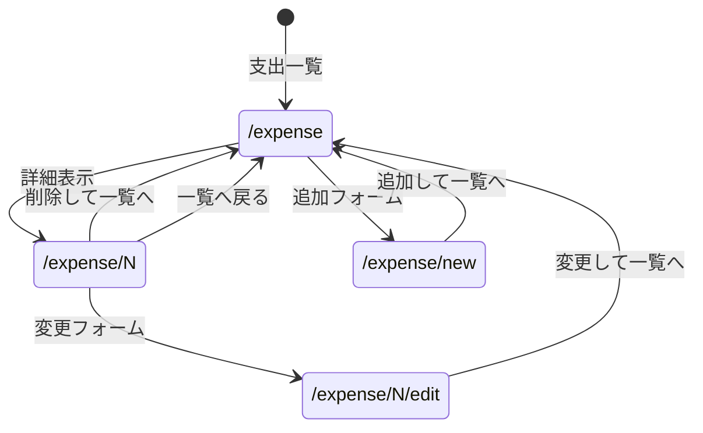
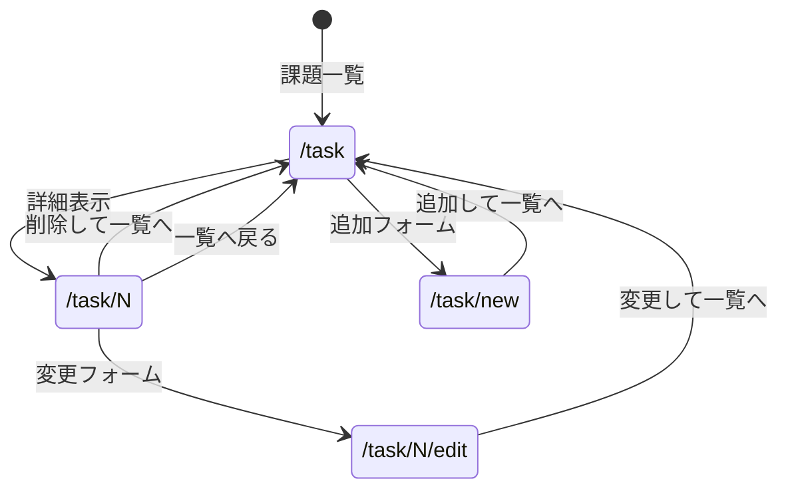
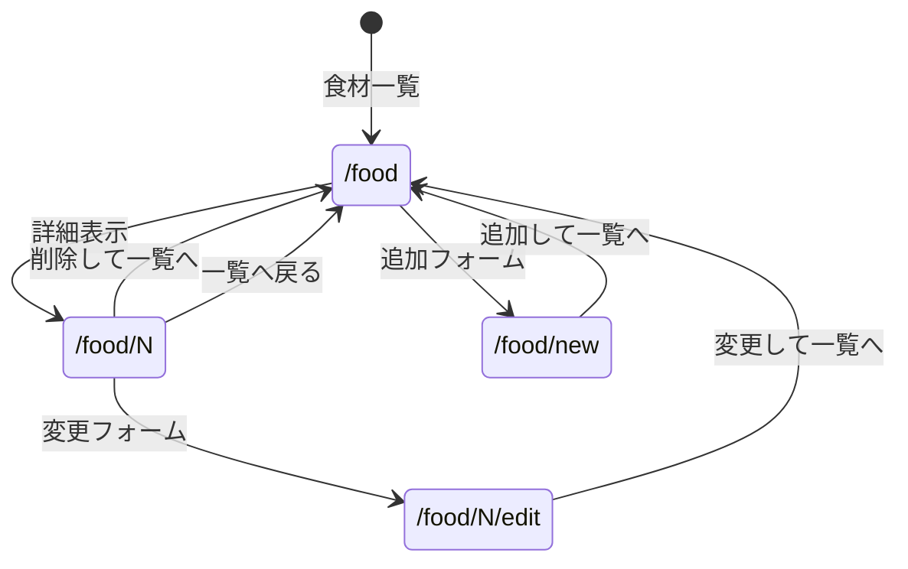

# レポート用システムの設計メモ（9-2）

京葉線以外の一覧表示ベースの Web アプリを 3 つ開発する。
いずれも「一覧・詳細・追加・削除・変更」を持ち、データはサーバ側の変数（配列）に保持する。
好きな楽曲の一覧（`/music`）とは題材が被らないものを選んだ。

REST API のルート設計（URL・HTTP メソッド）は未習のため、今後追記する。

---

## 1. 家計簿（/expense）

### 対象

- 管理するもの: 日々の支出の記録
- 利用者: 自分の出費を把握したい学生（一人暮らしの食費・交通費など）
- 性格: 金額（数値）・日付・カテゴリを扱う

### ページ遷移図

### スキーマ（expense）

項目名 | 型 | 説明
-|-|-
id | 数値 | 通し番号（一意）
date | 文字列 | 支出日（例: "2026-11-13"）
category | 文字列 | 食費/交通費/趣味/学業/その他
item | 文字列 | 品目（例: "学食の昼ご飯"）
amount | 数値 | 金額（円）
memo | 文字列 | 備考（空でもよい）

---

## 2. 課題管理（/task）

### 対象

- 管理するもの: 授業の課題・レポートの締切と進捗
- 利用者: 複数の授業の課題を抱える学生
- 性格: 締切（日付）・優先度（段階）・進捗状態（列挙）・完了フラグを扱う

### ページ遷移図

### スキーマ（task）

項目名 | 型 | 説明
-|-|-
id | 数値 | 通し番号（一意）
subject | 文字列 | 授業名（例: "Webプログラミング"）
title | 文字列 | 課題名（例: "第9回レポート"）
deadline | 文字列 | 締切日（例: "2026-11-20"）
priority | 数値 | 優先度（1:低 〜 3:高）
status | 文字列 | 未着手/作業中/提出済み

---

## 3. 食材在庫管理（/food）

### 対象

- 管理するもの: 冷蔵庫・戸棚にある食材とその賞味期限
- 利用者: 自炊する学生（買いすぎ・期限切れを防ぎたい人）
- 性格: 数量（数値）・賞味期限（日付）・保存場所（カテゴリ）・真偽値を扱う

### ページ遷移図

### スキーマ（food）

項目名 | 型 | 説明
-|-|-
id | 数値 | 通し番号（一意）
name | 文字列 | 食材名（例: "卵"）
quantity | 数値 | 残り数量
unit | 文字列 | 単位（個/パック/g など）
expire | 文字列 | 賞味期限（例: "2026-11-25"）
place | 文字列 | 保存場所（冷蔵/冷凍/常温）

---

## 補足

- 詳細表示・変更・削除のパス中の `N` は（図では mermaid の構文上 `:` を使えないため `N` と表記。実装では `:number` 形式）京葉線の `/keiyo2/:number` と同様、配列の添字を想定する（削除後の id との対応は実装時に検討）。
- 追加・変更・削除の具体的な API 設計は、第 10 回以降の内容を踏まえて今後追記する。
